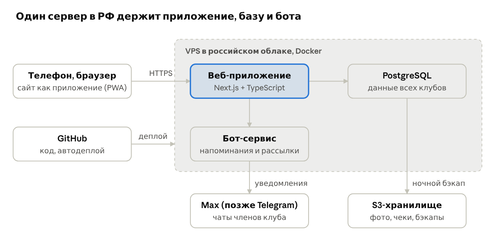

# План веб-приложения TeamUp

Версия 2, 26.10.2026. Первый клуб — охотколлектив №178.

Делаем сайт, который открывается с телефона, для одного коллектива, но сразу с разделением данных по клубам, чтобы потом без переделки превратить его в сервис для любых клубов. Первая версия закрывает то, что сейчас живёт в Excel: состав, взносы и штрафы, расходы, выезды с подсчётом мест, годовой отчёт, плюс бот и уведомления в Max. Хостинг в РФ, ориентировочно 6–8,5 тыс. руб. в год вместе с доменом и бэкапами. Код в публичном репозитории на GitHub под вашим аккаунтом.

Ключевые решения по вашим ответам:

- Мессенджер MVP — Max: туда ушли пенсионеры. Telegram добавим вторым каналом на этапе 2.
- Деньги только учитываем. Каждый платёж — отдельная запись с суммой и датой, частями можно. Платёж сначала заводится черновиком («я оплатил 3000» от члена или от вас за члена), а когда вы видите деньги на карте или в руках, подтверждаете. Онлайн-оплату подключим позже.
- Срок уплаты взноса — 1 сентября, но долги можно гасить в течение всего сезона и после его конца. Переплата становится депозитом на следующий сезон, долг тоже переходит.
- Места на выезде: кто первый откликнулся, тот едет, остальные в листе ожидания. Админ может принять сверх лимита («с раскладушкой»).
- Финансы видны всем членам целиком, ограничения видимости добавим настройкой позже.
- Сезон: с 11 января по 10 января следующего года, у каждого сезона свой входящий остаток. История сезонов копится в приложении с первого дня.
- Стартуем с сезона 2026: переносим состав, взносы, штрафы, расходы и выезды из текущего файла скриптом импорта.
- «Кто с кем едет» и автоматизацию работы председателя пока не делаем, но в модели данных место под них оставляем.

## Роли и права

Роль выдаётся человеку в конкретном клубе, а не навсегда: один человек может быть начфином в охотколлективе и рядовым членом в рыболовном клубе. Оба админа видят всё; разница в том, кто что меняет.

| Действие | Админ-финансы (начфин) | Админ общий (председатель) | Член |
| --- | --- | --- | --- |
| Смотреть бюджет, долги, отчёт | да | да | да |
| Подтверждать платежи, вносить расходы, штрафы | да | вносит расходы, а начфин подтверждает | заводит черновик «я оплатил N руб.» |
| Тарифы взносов и штрафов, бюджет сезона, закрытие сезона | да | нет | нет |
| Состав: принять, исключить, статус «охотится в сезон» | да | да | нет |
| Мероприятия, лимит мест, отметка кто был | да | да | откликается «еду / не еду» |
| Голосования | создаёт | создаёт | голосует |
| Паспорта и адреса, списки погранцам | да | да | только свои |
| Назначать роли | да | да | нет |

Каждое денежное действие пишется в журнал с автором и временем, операции не удаляются, а сторнируются. Это защищает начфина при спорах «я же платил». Роль «старший на выезде» добавим, когда дойдём до списков на охоту.

## Модель данных

Все деньги живут в одной схеме «начисление → оплата»: взнос, штраф или допвзнос за выезд — это начисление члену, долг — разница начислений и оплат. Тогда листы «Приход», «Отработка», «Выезды» и «ОтчетГодовой» становятся отчётами поверх одних и тех же данных, и цифры нигде не расходятся. У каждой таблицы есть поле «клуб».

| Сущность | Что хранит | Откуда в Excel |
| --- | --- | --- |
| Клуб | название, тип (охота, рыбалка, хоккей…), дата начала сезона, валюта | — |
| Пользователь | ФИО, телефон, привязка Max (позже Telegram) | ЧленыКоллектива+ |
| Членство | человек в клубе: роль, статус (активен, не охотится в сезон, выбыл), категория взноса (стандарт, пенсионный), номера билетов | Приход, СписокБилеты |
| Документы члена | паспорт, адрес, дата рождения; хранятся зашифрованными, отдельно | СписокПогранцам |
| Сезон | год, даты с 11.01 по 10.01, срок уплаты взноса (1 сентября), входящий остаток, закрыт или нет | Приход (входящий остаток) |
| Тариф | сумма взноса по категории, цена пропуска подсчёта и отработки на сезон | Приход, Отработка |
| Начисление | кому, сколько, за что (взнос, штраф, допвзнос, оплаченный невыезд), связь с мероприятием | Приход, Отработка, Выезды |
| Оплата | кто, сколько, дата, способ (наличные, перевод), статус (черновик, подтверждена, отклонена), кто завёл и кто подтвердил | Приход («внесено», «дата последнего платежа») |
| Депозит | переплата или долг, перенесённые на следующий сезон, с привязкой к члену | Приход («депозит») |
| Расход | статья, сумма, дата, кому заплачено, фото чека, связь с мероприятием | Расход |
| Статья бюджета | план на сезон по статьям дохода и расхода (лицензии, гостиница, соцпрограмма…) | Приход («Бюджет 2026») |
| Мероприятие | тип (выезд на охоту, подсчёт, отработка, собрание), даты, место, лимит мест, дедлайн отклика, обязательное ли | Выезды, Отработка |
| Участие | отклик (еду, не еду, не знаю), число гостей, потом факт «был / не был»; лист ожидания при переполнении | Выезды, Отработка |
| Работа на отработке | что сделано, объём и единица (солонцы, шт.; просеки, км) | Отработка |
| Лицензия | угодье, вид и возраст, цена, количество, сезон | Лицензии |
| Транспорт | марка, номер, VIN, владелец | Транспорт |
| Голосование | вопрос, варианты, голоса, срок; принятое решение попадает в правила клуба | Правила и договоренности |
| Отчёт о мероприятии | текст, фото и видео, добыча (этап 3) | — |
| Журнал | кто, что и когда изменил | — |

Долг члена = начисления − подтверждённые оплаты; черновики показываются отдельно («ожидает подтверждения») и в долг не идут. При закрытии сезона остаток по каждому члену автоматически переносится в следующий сезон депозитом или долгом.

Штрафы считаются автоматически: после обязательного подсчёта или отработки админ отмечает присутствовавших, и остальным активным членам начисляется штраф по тарифу (сейчас 3000 руб.). Начфин может отменить штраф с комментарием.

## MVP и этапы

MVP — это то, что позволит закрыть Excel к началу сезона 2027 (11 января): список, сбор бюджета, расходы, выезды, годовой отчёт. Сроки ориентировочные и зависят от того, сколько времени вы сможете тестировать.

1. **Этап 1, MVP (ноябрь — декабрь 2026).**
    - Вход без паролей: бот в Max присылает ссылку для входа; первый раз — по приглашению от админа.
    - Состав коллектива, роли, статус «охотится в сезон», категории взноса.
    - Сезон с бюджетом по статьям, начисления, частичные оплаты с черновиками и подтверждением, долги и депозиты, расходы с фото чека.
    - Мероприятия: отклик «еду / не еду» в порядке очереди, лимит мест в гостинице, лист ожидания и приём сверх лимита админом, расходы выезда (егерь, общий стол), отметка присутствия и автоштрафы.
    - Годовой отчёт в том же виде, что лист «ОтчетГодовой», с выгрузкой в Excel и PDF.
    - Бот в Max: новое мероприятие с кнопками «еду / не еду», напоминание откликнуться, напоминание о долге после 1 сентября, «я оплатил» прямо из чата.
    - Импорт сезона 2026 из вашего файла, ежедневные бэкапы, выгрузка всего клуба в Excel одной кнопкой.
2. **Этап 2 (январь — март 2027).**
    - Голосования и раздел «Правила клуба».
    - Telegram вторым каналом для тех, кто остался там (Bot API у Max и Telegram похожи, код бота общий).
    - Паспортные данные с согласиями и автоматические списки: погранцам, список участников охоты по шаблону «СписокБилеты», транспорт.
    - Лицензии и роль «старший на выезде».
3. **Этап 3 (весна 2027).**
    - Отчёты о мероприятиях с фото и видео, учёт добычи.
    - Прогноз бюджета по истории сезонов, «кто с кем едет», при желании ограничение видимости финансов.
4. **Этап 4, SaaS (после сезона на своём коллективе).**
    - Самостоятельная регистрация клуба, шаблоны под тип клуба (виды мероприятий, статьи бюджета, списки).
    - Тарифы и оплата подписки, лендинг, мобильное приложение для App Store, Google Play и RuStore.

Монетизация, которую предлагаю обсудить позже: бесплатно до 15 участников, дальше фиксированная подписка на клуб, фото и видео сверх лимита платно.

## Хостинг, стоимость, бэкапы

Предлагаю один виртуальный сервер в российском облаке (Timeweb Cloud или Selectel) и файловое хранилище S3 для бэкапов и фото. Российские дата-центры нужны из-за паспортных данных; сайт в них обычно без проблем открывается и из-за рубежа. Цены ниже приблизительные, уточню перед заказом.

| Что | Зачем | Примерно, руб./год |
| --- | --- | --- |
| VPS: 1–2 vCPU, 2 ГБ RAM, 30 ГБ диск | приложение и база данных | 5 000 – 7 000 |
| Домен .ru или .рф | адрес сайта | 200 – 1 000 |
| S3-хранилище, до 20 ГБ | бэкапы, чеки, потом фото | 300 – 600 |
| SSL-сертификат, бот в Max (позже Telegram) | защищённое соединение, уведомления | 0 |
| **Итого** | | **около 6 000 – 8 500** |

Это меньше одного годового взноса и укладывается в ваш порог «не десятки тысяч». Видео на этапе 3 увеличит хранилище; размер и длительность роликов ограничим.

Защита от потери данных, то есть то, с чего всё началось:

- База копируется каждую ночь в S3 у другого провайдера, храним 30 дневных и 12 месячных копий.
- Раз в неделю бот присылает начфину в Max выгрузку финансов в Excel.
- Восстановление из бэкапа проверяем до запуска, а не в день аварии.
- Код лежит на GitHub, сервер разворачивается из него заново за полчаса.

## Персональные данные: риски и что делать

Коротко: да, тот, кто собирает и хранит паспорта членов, становится оператором персональных данных и отвечает за них. Юрлица у коллектива нет, поэтому оператором фактически будете вы как физлицо (или председатель, если списки ведёт он). Это уже так с текущим Excel на гуглодиске, и там риск утечки выше, чем в приложении с правами доступа. Это моё понимание 152-ФЗ, а не юридическая консультация; перед этапом 2 стоит свериться с юристом общества охотников.

Что обычно требуется от оператора:

- Согласие каждого члена с целями, в том числе на передачу списков погранслужбе и охотхозяйству. В приложении это отметка при вводе паспорта с датой и текстом согласия.
- Хранение данных граждан РФ на серверах в РФ.
- Уведомление Роскомнадзора об обработке и, в случае утечки, сообщение об инциденте в течение суток.
- Разумная защита: ограниченный доступ, шифрование, журнал просмотров.

Штрафы за утечки с 2025 года стали очень крупными, но, по моим данным, привязаны к числу пострадавших от тысячи человек; для 30 членов реальный риск — штрафы за нарушение порядка обработки и репутация. Для SaaS вопрос станет серьёзнее: там нужны юрлицо или ИП, политика конфиденциальности и договор с клубами, где оператором выступает клуб, а вы обработчиком.

Что предлагаю:

1. В MVP паспортов и адресов нет, только ФИО, телефон и номера охотбилетов.
2. На этапе 2 паспортные данные вводит сам член вместе с согласием. Данные шифруются отдельно, видны только двум админам, каждый просмотр и выгрузка пишутся в журнал.
3. Кто не хочет хранить паспорт, попадает в список с пустой графой, как сейчас на бумажном бланке.
4. Паспорта из текущего Excel не импортируем без согласий, а сам файл после переезда лучше убрать с гуглодиска.

## Архитектура и стек под мультиклубный SaaS

Один язык на всё — TypeScript. Это один из самых востребованных языков: на нём проще всего найти разработчика на сопровождение, по нему много курсов, если решите учиться сами, и он подходит и для сайта, и для бота, и для будущего мобильного приложения. Код будет с тестами, инструкцией по запуску и описанием устройства в репозитории, чтобы его можно было передать. Многоклубность закладываем с первого дня, остальное наращиваем по этапам.

Члены клуба заходят с телефона; бот-сервис читает ту же базу и шлёт напоминания в мессенджеры, а база каждую ночь копируется в S3.

- **Стек:** Next.js + TypeScript, PostgreSQL, Drizzle или Prisma для работы с базой, Docker Compose на сервере, GitHub Actions для тестов и выкладки.
- **Вход:** ссылка от бота в Max и приглашения от админа, позже Telegram, SMS или почта. Пароли не храним.
- **Публичный репозиторий:** в нём только код. Реальные данные коллектива, файл Excel, ключи и пароли в репозиторий не попадают никогда; для демо — выдуманный клуб.
- **Мультиклубность:** у каждой записи поле «клуб», и база сама не отдаёт чужие строки (Row Level Security в PostgreSQL). Утечка между клубами исключается на уровне базы, а не только кода.
- **Под любой клуб:** виды мероприятий, статьи бюджета, категории взносов и шаблоны списков задаются настройками клуба, а не кодом. Охотничьи «подсчёт», «отработка», «лицензии» станут шаблоном «Охотколлектив».
- **Мобильное приложение потом:** сайт сразу делаем PWA, его можно поставить на экран телефона. Нативное приложение на React Native переиспользует тот же сервер.
- **Оплата потом:** платёж просто создаёт запись «Оплата» со способом «онлайн», модель данных менять не придётся.

## Название и домен

Продукт называется TeamUp. Наш клуб внутри приложения — «ОК №178» (охотколлектив №178), латиницей HuntingSquad 178.

Учесть: на рынке уже есть сервис Teamup (teamup.com, общий календарь для команд). Для своего клуба это не мешает, но для продажи как SaaS стоит отличаться в домене и логотипе и перед запуском проверить товарный знак.

| Что | Вариант |
| --- | --- |
| Репозиторий на GitHub | teamup |
| Домены для проверки на reg.ru | teamup.club, teamupclub.ru, teamup-club.ru |
| Адрес нашего клуба в приложении | teamup.club/ok178 |

## Следующие шаги

1. Вы создаёте публичный репозиторий на своём GitHub (название teamup) и подключаете его к проекту.
2. Я делаю каркас: модель данных, роли, импорт сезона 2026 из вашего Excel на тестовую базу.
3. Затем бот в Max и экраны взносов и выездов; показываю вам на тестовом сервере.
4. Перед запуском покупаем VPS и домен, проверяем восстановление из бэкапа, приглашаем коллектив.
